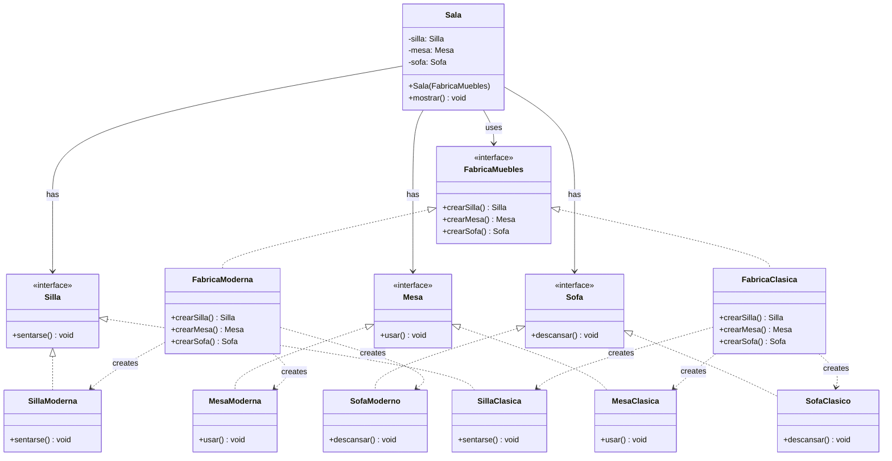
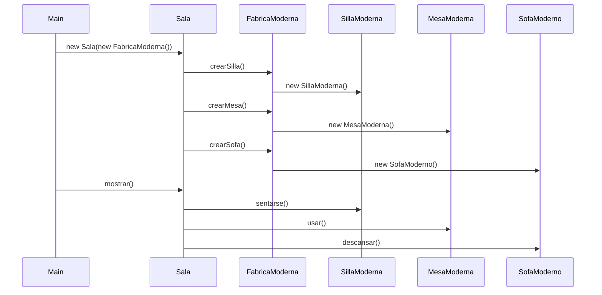
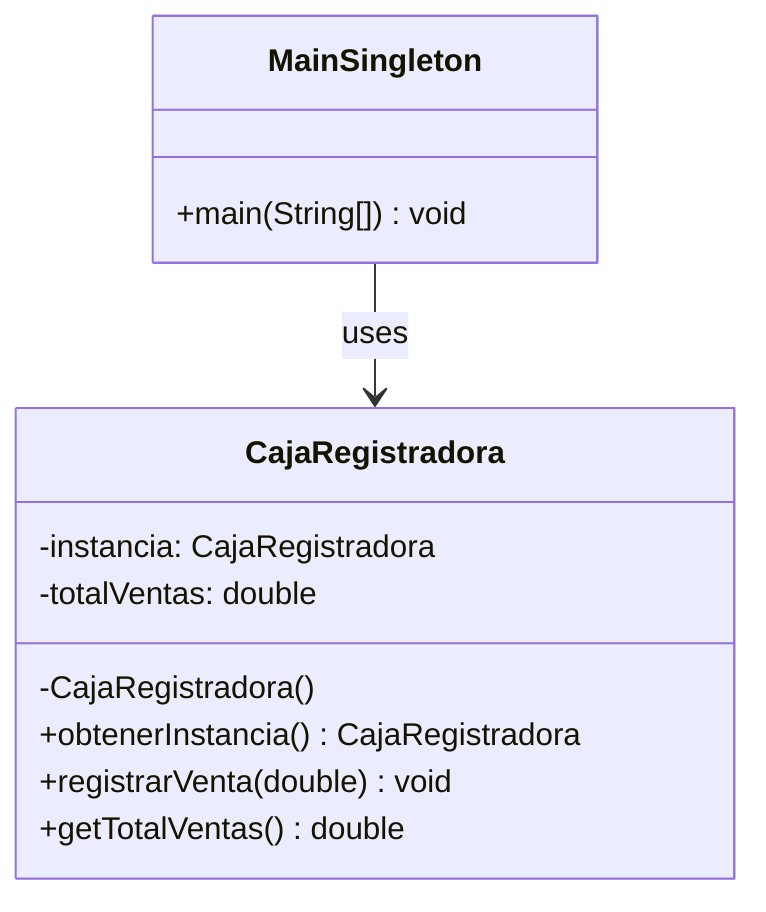
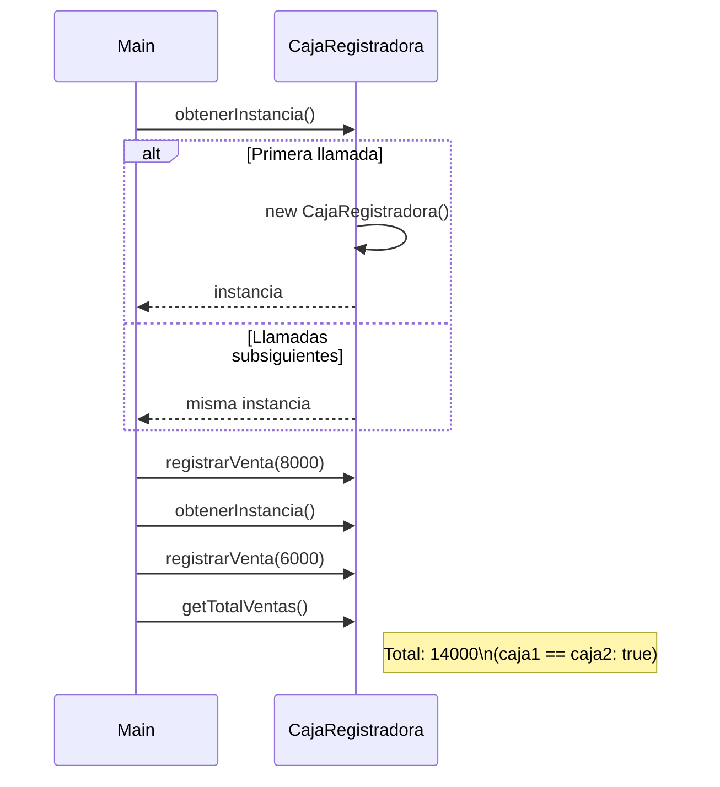
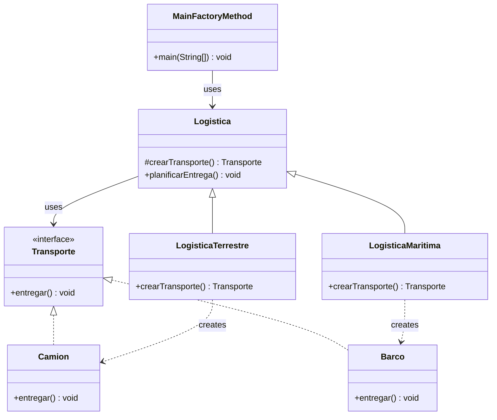
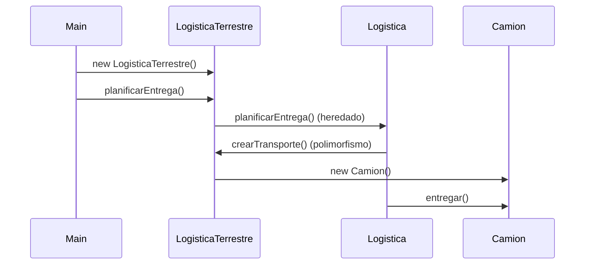
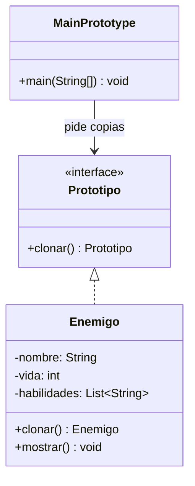

# Patrones Creacionales - Documentación y Diagramas

Este proyecto implementa cinco patrones de diseño creacionales fundamentales en Java:
1. **Abstract Factory** (Fábrica Abstracta)
2. **Singleton** (Instancia Única)
3. **Factory Method** (Método Fábrica)
4. **Builder** (Constructor)
5. **Prototype** (Prototipo)

---

## Tabla de Contenidos

- [Patrón Abstract Factory](#patrón-abstract-factory)
- [Patrón Singleton](#patrón-singleton)
- [Patrón Factory Method](#patrón-factory-method)
- [Cómo Ejecutar](#cómo-ejecutar)
- [Patrón Builder](#patrón-builder)
- [Patrón Prototype](#patrón-prototype)

---

## Patrón Abstract Factory

### Propósito
Proveer una interfaz para crear familias de objetos relacionados o dependientes sin especificar sus clases concretas.

### Diagrama de Clases



### Estructura del Código

| Componente | Clase/Interfaz | Descripción |
|------------|----------------|-------------|
| **AbstractProduct** | `Silla`, `Mesa`, `Sofa` | Interfaces que definen los tipos de productos |
| **ConcreteProduct (Modern)** | `SillaModerna`, `MesaModerna`, `SofaModerno` | Implementaciones para estilo moderno |
| **ConcreteProduct (Classic)** | `SillaClasica`, `MesaClasica`, `SofaClasico` | Implementaciones para estilo clásico |
| **AbstractFactory** | `FabricaMuebles` | Interfaz con métodos de creación |
| **ConcreteFactory** | `FabricaModerna`, `FabricaClasica` | Fábricas que crean familias completas |
| **Client** | `Sala` | Usa la fábrica sin conocer clases concretas |

### Flujo de Ejecución



### Ventajas
- **Consistencia**: Garantiza que los productos de una familia combinan entre sí
- **Desacoplamiento**: El cliente no conoce clases concretas
- **Extensibilidad**: Fácil agregar nuevas familias (ej. estilo Industrial, Rústico)
- **Principio Open/Closed**: Abierto para extensión, cerrado para modificación

---

## Patrón Singleton

### Propósito
Garantizar que una clase tenga una única instancia y proporcionar un punto de acceso global a ella.

### Diagrama de Clases



### Estructura del Código

| Componente | Clase/Método | Descripción |
|------------|--------------|-------------|
| **Instancia única** | `private static CajaRegistradora instancia` | Variable estática que guarda la única instancia |
| **Constructor privado** | `private CajaRegistradora()` | Impide instanciación externa con `new` |
| **Método de acceso** | `public static obtenerInstancia()` | Punto de acceso global (lazy initialization) |
| **Estado compartido** | `totalVentas` | Dato que se acumula en la única instancia |

### Flujo de Ejecución



### Consideraciones Importantes

⚠️ **Esta implementación básica NO es thread-safe**

Para entornos multi-hilo, usar:

```java
// Opción 1: Double-checked locking
public static CajaRegistradora obtenerInstancia() {
    if (instancia == null) {
        synchronized (CajaRegistradora.class) {
            if (instancia == null) {
                instancia = new CajaRegistradora();
            }
        }
    }
    return instancia;
}

// Opción 2: Enum (recomendado por Joshua Bloch)
public enum CajaRegistradora {
    INSTANCIA;
    private double totalVentas = 0.0;
    public void registrarVenta(double monto) { totalVentas += monto; }
    public double getTotalVentas() { return totalVentas; }
}
```

### Ventajas
- **Control de acceso**: Único punto de acceso global
- **Memoria**: Una sola instancia en memoria
- **Estado compartido**: Todas las partes del sistema ven los mismos datos

---

## Patrón Factory Method

### Propósito
Definir una interfaz para crear un objeto, pero dejar que las subclases decidan qué clase instanciar.

### Diagrama de Clases



### Estructura del Código

| Rol | Clase/Interfaz | Descripción |
|-----|----------------|-------------|
| **Product** | `Transporte` | Interfaz común para todos los productos |
| **ConcreteProduct** | `Camion`, `Barco` | Implementaciones concretas |
| **Creator** | `Logistica` (abstract) | Define `planificarEntrega()` y declara `crearTransporte()` abstracto |
| **ConcreteCreator** | `LogisticaTerrestre` | Implementa `crearTransporte()` retornando `Camion` |
| **Client** | `MainFactoryMethod` | Usa `Logistica` sin conocer productos concretos |

### Flujo de Ejecución



### Extensibilidad - Agregar Transporte Marítimo

```java
// 1. Nueva ConcreteCreator (sin tocar Logistica)
public class LogisticaMaritima extends Logistica {
    @Override
    protected Transporte crearTransporte() {
        return new Barco();  // ConcreteProduct existente
    }
}

// 2. Uso en cliente (sin modificar Logistica ni Main)
Logistica logistica = new LogisticaMaritima();
logistica.planificarEntrega();  // Entrega por mar
```

### Ventajas
- **Desacoplamiento**: Creator no conoce ConcreteProduct
- **Extensibilidad**: Nuevos productos = nuevas subclases Creator
- **Single Responsibility**: Cada Creator decide su producto
- **Polimorfismo**: Cliente usa Creator abstracto

---

## Patrón Builder

### Propósito
Separar la construcción de un objeto complejo de su representación, armándolo paso a paso y permitiendo omitir las partes opcionales.

### Diagrama de Clases

```mermaid
classDiagram
    class Computador {
        -procesador: String
        -ramGB: int
        -almacenamientoGB: int
        -tarjetaGrafica: String
        -wifi: boolean
        -bluetooth: boolean
        -Computador(Builder)
        +mostrar() void
    }
    class Builder {
        +Builder(String, int)
        +conAlmacenamiento(int) Builder
        +conTarjetaGrafica(String) Builder
        +conWifi() Builder
        +conBluetooth() Builder
        +build() Computador
    }
    class MainBuilder {
        +main(String[]) void
    }

    Computador +-- Builder : clase interna
    Builder ..> Computador : crea
    MainBuilder --> Builder : usa
```

### Estructura del Código

| Rol | Clase | Descripción |
|-----|-------|-------------|
| **Product** | `Computador` | Objeto complejo e inmutable, con constructor privado |
| **Builder** | `Computador.Builder` | Un método por cada parte opcional y `build()` al final |
| **Client** | `MainBuilder` | Encadena llamadas para armar el objeto |

### Ventajas
- **Legibilidad**: `.conWifi().conBluetooth()` se lee como una frase
- **Sin constructores gigantes**: no hay que recordar el orden de los parámetros
- **Inmutabilidad**: el objeto final no cambia después de `build()`

---

## Patrón Prototype

### Propósito
Crear nuevos objetos copiando una instancia existente en lugar de construirlos desde cero.

### Diagrama de Clases



### Estructura del Código

| Rol | Clase/Interfaz | Descripción |
|-----|----------------|-------------|
| **Prototype** | `Prototipo` | Interfaz que declara `clonar()` |
| **ConcretePrototype** | `Enemigo` | Se copia a sí mismo (copia profunda de la lista) |
| **Client** | `MainPrototype` | Clona el enemigo base y modifica solo lo que cambia |

### Ventajas
- **Rapidez**: copiar es más fácil que repetir toda la configuración
- **Independencia**: el cliente no necesita conocer cómo se construye el objeto
- **Copia profunda**: modificar un clon no afecta al original

---

## Cómo Ejecutar

### Requisitos
- Java 11 o superior
- Maven (opcional, para compilación)

### Compilación y Ejecución Directa

```bash
# Compilar todos los archivos
javac -d out src/main/java/com/patrones/**/*.java

# Ejecutar Abstract Factory
java -cp out com.patrones.abstractfactory.Muebles

# Ejecutar Singleton
java -cp out com.patrones.singleton.MainSingleton

# Ejecutar Factory Method
java -cp out com.patrones.factorymethod.MainFactoryMethod

# Ejecutar Builder
java -cp out com.patrones.builder.MainBuilder

# Ejecutar Prototype
java -cp out com.patrones.prototype.MainPrototype
```

### Con Maven (si existe pom.xml)

```bash
mvn compile exec:java -Dexec.mainClass="com.patrones.abstractfactory.Muebles"
mvn compile exec:java -Dexec.mainClass="com.patrones.singleton.MainSingleton"
mvn compile exec:java -Dexec.mainClass="com.patrones.factorymethod.MainFactoryMethod"
mvn compile exec:java -Dexec.mainClass="com.patrones.builder.MainBuilder"
mvn compile exec:java -Dexec.mainClass="com.patrones.prototype.MainPrototype"
```

### Salida Esperada

#### Abstract Factory
```
=== DEMOSTRACIÓN PATRÓN ABSTRACT FACTORY ===

--- Sala MODERNA ---
Te sientas en una silla moderna de metal y plástico
Pones el computador en una mesa moderna de vidrio
Descansas en un sofá moderno gris de líneas rectas

--- Sala CLÁSICA ---
Te sientas en una silla clásica de madera tallada
Cenas en una mesa clásica de roble
Descansas en un sofá clásico de terciopelo con botones

=== FIN DE LA DEMOSTRACIÓN ===
```

#### Singleton
```
=== DEMOSTRACIÓN PATRÓN SINGLETON ===

Caja 1 obtenida. Registrando venta de $8,000...
Caja 2 obtenida. Registrando venta de $6,000...

--- RESULTADOS ---
Total en caja: $14000.0
¿Es la misma caja? (caja1 == caja2): true

=== FIN DE LA DEMOSTRACIÓN ===
```

#### Factory Method
```
=== DEMOSTRACIÓN PATRÓN FACTORY METHOD ===

Entregando por tierra en camión.

=== FIN DE LA DEMOSTRACIÓN ===
```

#### Builder
```
=== DEMOSTRACIÓN PATRÓN BUILDER ===

--- PC BÁSICO ---
Computador -> Procesador: Intel Core i3 | RAM: 8 GB | Disco: 256 GB | Gráfica: integrada | WiFi: no | Bluetooth: no

--- PC GAMER ---
Computador -> Procesador: AMD Ryzen 7 | RAM: 32 GB | Disco: 1000 GB | Gráfica: NVIDIA RTX 4070 | WiFi: sí | Bluetooth: sí

=== FIN DE LA DEMOSTRACIÓN ===
```

#### Prototype
```
=== DEMOSTRACIÓN PATRÓN PROTOTYPE ===

--- RESULTADOS ---
Orco | Vida: 100 | Habilidades: [Golpe, Escudo]
Orco Jefe | Vida: 300 | Habilidades: [Golpe, Escudo, Grito de guerra]
Orco Soldado | Vida: 100 | Habilidades: [Golpe, Escudo]

¿El original conserva sus 2 habilidades? Sí: la copia es independiente.

=== FIN DE LA DEMOSTRACIÓN ===
```

## Resumen Comparativo

| Aspecto | Abstract Factory | Singleton | Factory Method | Builder | Prototype |
|---------|------------------|-----------|----------------|---------|-----------|
| **Problema** | Familias de productos relacionados | Una sola instancia global | Delegar creación a subclases | Objeto con muchas partes opcionales | Crear de nuevo es costoso o repetitivo |
| **Alcance** | Múltiples productos | Una clase | Un producto por Creator | Un objeto complejo | Copias de un objeto existente |
| **Flexibilidad** | Cambiar familia completa | Acceso global controlado | Extender con nuevos productos | Armar variantes paso a paso | Clonar y cambiar solo lo necesario |
| **Complejidad** | Media | Baja | Media | Media | Baja |
| **Uso típico** | UI toolkits, temas, configuraciones | Logging, configuración, cache | Frameworks, librerías | Configuraciones, consultas, pedidos | Juegos, documentos, plantillas |

---

## Referencias

- **Design Patterns: Elements of Reusable Object-Oriented Software** - Gang of Four (GoF)
- **Head First Design Patterns** - Freeman & Robson
- **Effective Java** - Joshua Bloch (Item 3: Singleton con enum)

---

*Documentación generada para el curso de Programación II - Patrones Creacionales*